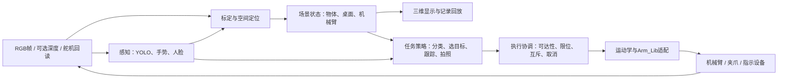

# YOLO、三维空间定位与组合任务

> 本页是官方 ROS 2 工程导入前的应用架构草案。2026-09-20 已归档的[官方源码](atlas-200i-dk-a2/06-官方源码导入审计.md)提供五关节 URDF、FK/IK 和桌面平面分拣实现；草案中的三维定位、统一任务状态与结果验证仍未成为实机功能。

**状态：开发方案草案，尚未实现。**用户确认继续使用YOLO，并按空间定位与抓取理解三维场景还原。本文不预先确定YOLO版本、三维框架或深度相机型号。

## 要实现的闭环

识别出“是什么”，还需要知道“在机器人坐标系哪里、姿态如何、是否够得着、是否适合抓取”，并在动作结束后验证结果。三维显示与机器人控制应读取同一个场景状态。



不让每个识别模型直接写舵机。三维界面发出的操作也应经过执行协调，与自动任务共享同一套限位、资源占用和停止规则。

## 三维分成三项工作

### 1. 机械臂模型与真实状态

把已有STL组装为带关节轴、父子关系、零位偏移和限位的模型。需要确认STL单位和各link局部坐标，补上夹爪的几何与运动表示。展示姿态来自实际回读，不用“上次下发的角度”冒充当前角度；无法读数时标为未知/过期。

需要分别保存几何模型、关节配置和舵机编号映射。对外使用统一坐标/单位，SDK边界再转换角度单位、方向和零点。

### 2. 桌面与物体的可度量位置

现有资料只确认RGB摄像头。初期可以在**已知桌面平面**的假设下标定相机，并将图像点映射到该平面，从四颜色积木开始验证。它只适合约束明确的工作面，不能宣称获得了任意物体的完整三维形状。

直接使用检测框中心通常不是接触点或最佳抓取点。有高度的物体会产生平面投影误差；要给出有效工作区域、高度范围和不确定性，超出范围拒绝自动抓取或转人工确认。

若后续要处理堆叠、高度变化和遮挡，再引入深度/多视角信息：RGB与深度配准、有效深度筛选、目标点云、桌面剔除、姿态/抓取点估计。深度失效、反光/透明物体和动态移动都应显式进入不可定位状态。

### 3. 可抓取的场景表示

物体除了类别和mesh，还要有基座坐标下的位置、尺寸估计、抓取候选、投放区域及观测时间。机械臂模型、桌面、垃圾桶与障碍物使用同一坐标树。高保真纹理和外观不作为第一阶段前置条件。

## 坐标契约（拟定）

- `base`：机械臂基座；具体轴向由实际安装标定，不凭显示界面设定。
- `tool`：末端工具；夹爪参考点必须明确。
- `camera`：相机光学坐标；约定x右、y下、z前，并在适配边界处理与机器人坐标系的差异。
- `table`：桌面参考坐标。
- 三维位置统一米，内部旋转统一弧度或明确顺序的四元数；若采用四元数，本文草案约定`xyzw`。像素以原始相机图像坐标为准。
- `T_base_camera`表示将相机坐标变换至基座坐标。变换都携带`calibration_id`与时间，不混用不同版本标定。

有有效深度Z并完成去畸变时，点可写成 `p_camera = Z * K^-1 * [u,v,1]^T`，再用齐次变换得到 `p_base = T_base_camera * p_camera`。该式不能在没有度量深度或平面约束时凭空产生距离。

如果相机固定在机械臂上：`T_base_camera(t) = T_base_tool(q(t)) * T_tool_camera`，需要手眼标定和图像/关节状态时间对齐；相机若外置固定，则使用固定外参。**相机安装方式是近期必须确认的硬件事实。**

## 模块与数据接口草案

这些是未来应用层接口，不是Arm_Lib现有API，也未决定用ROS2消息、进程内对象或网络服务实现。

| 接口 | 核心字段/单位 | 状态与约束 |
|---|---|---|
| `FrameBundle` | frame_id、timestamp、camera_id、RGB引用、图像尺寸、可选depth_m、calibration_id | depth可缺失；缺失时不伪造深度 |
| `Detection2D` | frame_id、model_id/version、track_id可选、class_id/label、confidence、bbox_xyxy_px、可选mask/keypoints | 携带坐标参考和变换；不同模型标签独立命名 |
| `ObjectState3D` | object_id、frame_id、pose_base、extent_m、观测时间、定位方法、误差指标/协方差、calibration_id | 未定位用null；不使用(0,0,0)表示失败 |
| `JointState` | 5个机械关节及单独夹爪状态、timestamp、来源、有效标记 | 保留SDK原始读值与规范化后的值；回读失败标未知 |
| `SceneSnapshot` | scene_id/revision、坐标变换、机器人状态、桌面/容器/目标/障碍物 | 显示、策略和规划引用同一快照 |
| `RecognitionEvent` | event_id、type、target_id、置信度、有效期、来源frame_id | 手势/语音需要去抖及冷却；身份识别另立任务，不由人脸框推断身份 |
| `PickPlaceRequest` | command_id、object_id、目标容器、scene_revision、calibration_id、deadline、速度约束 | 拒绝过期场景/无定位/未知类别；只引用已批准的目标区域 |
| `ExecutionStatus` | command_id、state、stage、error、反馈关节、verification_evidence | 区分发送、到位、抓取验证、最终成功 |

建议先把旧YOLO脚本包装成返回`Detection2D[]`的纯感知函数，并保存原始推理输出用于核对。后处理适配必须绑定模型的真实张量布局，不能把所有YOLO版本的输出当作旧YOLOv5布局。

## 如何组合任务

| 组合 | 识别与定位 | 策略 | 执行与验收 |
|---|---|---|---|
| 垃圾分类抓放 | YOLO检测/可选分割→空间定位 | 物体标签映射到业务垃圾类别，再映射到容器；不确定类拒绝自动投放 | 可达性与路径检查→接近→夹取→抬升→投放；检查目标是否离开原位/进入目标区域 |
| 手势选物或启动 | 手势事件+场景中的稳定目标 | 手势选择颜色/类别或确认任务；绑定目标ID而非列表第一项 | 同一个PickPlace流程；动作执行中不重复触发 |
| 人脸跟踪/拍照 | 人脸框/关键点→跟踪目标；可叠加语音事件 | 跟踪模式使用单一相机/机械臂所有权；拍照对应明确图像帧 | 与抓取互斥；照片写入完成才报告拍照成功 |
| 组合演示 | 手势选择类别→垃圾检测定位→3D预览→确认抓放→语音/灯光反馈 | 识别事件只改变任务状态，不直接抢占正在执行的舵机命令 | 失败留在可解释状态；重新观测后才能重试 |

“模型结果融合”首先是对齐frame_id、timestamp、track_id和坐标，而不是把多个置信度简单相加。抓取、跟踪和学习模式不能同时控制同一机械臂。

## 执行状态与证据

拟定流程：`IDLE → OBSERVING → TARGET_READY → PLANNING → EXECUTING → VERIFYING → SUCCEEDED`；各阶段可转`FAILED`、`CANCEL_REQUESTED`，只有确认停止后才转`CANCELLED`。

- command_id去重，机械臂同一时刻只接受一个动作任务；观察可并行。
- 每次执行前检查关节配置、标定版本、观测时效、工作空间及末端姿态可达性。
- 通信发送成功不代表运动完成，sleep结束也不代表完成；读数和场景反馈构成证据。
- SDK没有证明支持通用硬停止接口，因此软件取消先定义为停止后续命令；在途运动停止能力须设备验证，不能把`Arm_Action_Mode(0)`包装成通用急停。
- 执行中相机丢帧或目标移动时，不使用无限期旧位置继续规划。学习模式会改变扭矩状态，应作为独立维护模式。

## 分步开发与验收

| 步骤 | 交付物 | 验收证据 |
|---|---|---|
| 0. 设备事实核对 | SDK/固件/模型/相机清单、关节配置、环境锁定 | 只读设备日志、已验证限位及读写错误语义；先确认再运动 |
| 1. 离线视觉复现 | 模型元数据、相机录制样本、统一Detection2D | 固定样本预处理/输出核对、类别映射、延迟和错误样例；不调用Arm_Lib |
| 2. 三维机械臂与桌面 | 关节模型、坐标树、显示和回放 | 读角度与模型姿态一致；单位、轴向、零位一致 |
| 3. 平面定位 | 相机标定、目标定位与误差报告 | 多个测量点的XY误差、有效区域和高度限制；达不到夹爪余量就不自动抓 |
| 4. 单目标抓放 | 受控执行模块、固定目标容器、过程日志 | 成功率分开统计检测、定位、夹取、投放；失败可停止且可追溯 |
| 5. 任务组合 | 手势/人脸/语音事件、任务状态机、资源互斥 | 重复触发、取消、断流、无目标、目标移动、不可达的行为可验证 |
| 6. 扩展三维 | 深度或多视角、物体高度/朝向、碰撞几何 | 度量误差、遮挡场景、时间同步和规划约束；与平面基线比较 |

先由夹爪开口、物体尺寸和实测控制误差反推允许的定位误差及延迟，再设验收阈值；本次不编造“毫米级”或实时帧率指标。

## 后续代码目录建议

```text
src/
  perception/     # 模型适配、预后处理、手势/人脸事件
  spatial/        # 标定、坐标变换、定位和机械臂几何
  scene/          # 当前场景状态、记录与回放
  tasks/          # 分类抓放、跟踪拍照、组合策略
  execution/      # 命令生命周期、互斥和反馈验证
  adapters/       # 相机、Ascend推理、Arm_Lib
config/           # 设备、模型、标定的版本化配置
```

此目录只是边界建议，本次没有创建空实现或宣布框架选型。原始资料继续留在`资料/`，实际应用经离线验证后再逐步接硬件。
