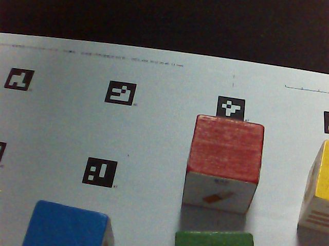

# 探索记录：从一箱资料到一条能跑的分拣流水线

2026-09-18 — 2026-09-29。本文按时间讲这段开发做了什么、为什么那样做、以及哪些判断被实测推翻。结论性数据见[需求规格](10-需求规格.md)，逐条实机证据见[硬件实测](../05-板卡连接与硬件实测.md)。

---

## 一、起点：先分清三种“有”

拿到的是一箱课程资料：昇腾开发板、Dofbot 六舵机机械臂、腕部 USB 相机，还有几 GB 的官方包、Notebook、模型文件。

第一件事不是写代码，是给“有”分级：

| 状态 | 含义 |
|---|---|
| **文件存在** | 盘里有这个模型、这段代码 |
| **官方示例描述可运行** | 文档说它能跑 |
| **本机实测通过** | 我们在这台设备上跑过，有记录 |

这条约定贯穿全程。后面每一个结论都标注日期、设备、版本、条件和证据，因为“资料里有”和“我们验证过”在工程上是两件事——这段开发里至少三次差点把前者当成后者。

同时划定安全边界：**不整本执行含顶层运动指令的课程 Notebook**。那些脚本会直接驱动机械臂，而我们当时还不知道这台设备的限位在哪。

---

## 二、让它动起来，但先知道哪里不能动

早期实测发现 1–5 号单舵机写入不生效，六舵机批量小步动作和回读可用——于是所有运动都走“批量写 + 分段 + 每段核对回读”的通道。

更关键的是**禁入区**。机械臂底座装在 9 cm 高的平台上，手臂可以转到平台正上方然后撞上去。我们用四次实际接触（手动折叠贴到平台、回程碰撞等）和日志里 195 个无碰撞姿态，拟合出一个平台包络模型：

- 平台是绕一轴的“盒子”：半径 8 cm，顶面 z = +7.6 cm
- 夹爪包络分两段：舵机外壳两侧各 3.5 cm，手指段两侧各 1.5 cm
- 四次接触的余量都 ≤ +0.1 cm，195 个安全姿态的余量都 ≥ +0.6 cm

两者之间只有 5 mm 的区分带，所以模型额外留了 0.4 cm。**这个模型是从碰撞数据反推的，不是从图纸抄的**——图纸没有，而且夹爪外壳的实际包络和理论尺寸不一样。

桌面高度同样靠**触碰**测定：让指尖轻触桌面，读正解坐标，得到 −1.42 cm。这个值后来成了整个系统的基准，也在第七节里救了一次命。

---

## 三、自己的数据集和模型

官方包里有一个三类垃圾检测模型（鱼骨 / 报纸 / 注射器），但它和我们的任务对不上：课程物块是**四类贴纸方块**，而且官方模型没有“其他”类。更早的课程资料里还有一套"按颜色分拣"的模型，但**颜色标签不等于垃圾类别**——Blue/Green/Red/Yellow 不能直接当成四类垃圾。


*物块六个面贴不同图案，同一块的六个面属于同一个垃圾类别。贴纸面朝上时，传统的"轮廓 + 前景差分"找不到它——白贴纸压在白纸上。*

所以训练自己的四类检测器。关键问题是**标注从哪来**。

### 标注来自摆放位置，不来自识别

做法是：脚本随机指派四个地图码，操作员把对应物块放上去（朝上的面和角度随意），扫描后按码中心在正射图上对齐真实轮廓，再用相机模型把 3 cm 立方体的 8 个角投影到 8 个视角，自动生成 YOLO 框。



*一轮采集的一个视角。地图上的 ArUco 码既用于确定桌面坐标系，也用于确定每块的真值位置。*

**标签来自"我把它放在了哪个码上"，检测器没有参与**。这一点很重要：如果标注用模型自己的输出，训练就是在强化它已有的偏见。

采集 21 轮共 160 张图、281 个框。中途出过 3 次人为失误（物块没挪到新码、红蓝放反、放到相邻码），都按正射图核对后改正，并写了 `check_round.py` 在以后自动查出这类错误。

### 两个关于验证集的教训

**验证集必须按整轮留出，不能按帧切。** 同一轮的 8 个视角拍的是同一个摆放，高度相关；按帧随机划分会让验证集里出现训练集同一摆放的另一个角度，指标虚高。

**合成增强有效，但有两个必须的约束。** 把 20 张面纹理当作 3 cm 立方体渲染进**真实扫描画面**（用该视角已标定的相机位姿），可以放在任意位置、任意朝向、任意面朝上，框精确已知。模拟了透视、光照、接触阴影、圆角与噪声。两个约束是：只在该视角**能看到**的地图点上放置；合成块**不得遮挡**画面里的真实块——否则真实块的标注就成了错标。

生成 800 帧、3 138 个框。混合训练结果：

| 版本 | 训练数据 | mAP@0.5 | mAP@0.5:0.95 |
|---|---|---|---|
| v1 | 136 真实，60 轮 | 0.918 | 0.667 |
| v2 | 136 真实，100 轮 | 0.932 | 0.741 |
| **v3** | 136 真实 + 800 合成，60 轮 | **0.952** | **0.757** |

随后试了"只用真实数据微调"，mAP@0.5 反而掉到 0.877（"其他"类 0.87 → 0.72）——136 张真实图撑不起那么长的微调。**这次尝试失败了，但它被记录下来了**，免得以后有人重走。

---

## 四、只用腕部相机的闭环

相机装在腕部，一个视角最多只能看到地图的 29%（视场 36°，相机最高离桌约 21 cm）。所以流程是：

```text
扫描 11 个视角 → 每个看到 ≥3 个定位码的视角各算一次 base_T_map，取中位数
→ 所有视角重采样到桌面平面和物块顶面平面（1 mm/px）
→ 在顶面正射图上，物块顶面是不变形的 30×30 px 正方形
→ 四类检测器在每个视角上投票，框中心投到顶面平面归给对应物块
```


*单个视角的检测结果。注意画面右侧的物块被边缘裁切——这类框的中心不是物块的中心，必须单独处理。*


*所有视角融合后的顶面正射图，四块的中心、朝向和类别。地图上的 ArUco 码提供坐标系。*

**一个值得记的修复**：被画面边缘裁切的检测框原本只参与投票、不参与定位，而地图边缘和近端的一排物块在**所有**视角里都被裁切，于是整块丢失（60 块里丢 11 块）。改成"裁切框之间单独聚类、标记为近似、再用正射图在更大窗口内对齐"后，变成 60/60 找到、60/60 类别正确。

离线评分（15 轮手摆的 60 块）：中心误差中位 0.0 cm、p90 1.04 cm、最大 1.55 cm；按"中心 ≤ 1 cm 且朝向 ≤ 12°"的抓取容差，50/60 可直接抓。

---

## 五、上板：`.om` 转换的四个坑

模型要在昇腾 NPU 上跑，必须转成 `.om`。`atc` 报的错是：

```
EZ3002: Optype [Conv2D] of Ops kernel [AIcoreEngine] is unsupported
```

这条信息**与真实原因毫无关系**。逐个排查出四个问题：

1. 缺 `libascend_hal.so`——没有驱动时用工具包自带的替身库
2. 缺 `libxml2`——镜像里装上
3. **容器是 Python 3.10**——工具包的 TBE 代码有 `from collections import Iterable`，这个写法在 3.10 已失效。换成 3.9（与板上一致）后 `Conv2D` 才通过
4. **numpy 2.x**——TBE 用了 `np.float_`，2.0 已移除，固定 `numpy<2`

第 3 个是关键。定位方法是构造一个**只含一个 `Conv` 的极小 ONNX**：如果它也失败，问题就在环境而不是模型。这个对照把排查范围一次性缩小了。

最终在 Mac 容器里 20 秒完成转换，**不需要板卡**（之前在板上转换曾把 4 GB 内存占满，SSH 失去响应，只能断电重启）。板上验证：NPU **12.9 ms/帧**，比 Mac 的 ONNX（16.1 ms）还快；与 ONNX 的检测结果逐框对照，类别一致、框差 ≤ 1 px、置信度差 ≤ 0.001。

---

## 六、提速，以及"先改速度再收统计"

第一次端到端自动分拣跑通后，每块需要 35.5 秒。写了统计脚本从日志直接算分阶段耗时，立刻看出问题：

| 阶段 | 耗时 | 占比 |
|---|---|---|
| 搬运投放 | 18.2 s | 51% |
| **夹爪唤醒** | **7.3 s** | **21%** |
| 接近 | 5.6 s | 16% |
| 抬起 | 2.8 s | 8% |
| 夹取 | 1.1 s | 3% |

那 7.3 秒是为绕开一个硬件毛病付的：夹爪舵机有时会**完全忽略**大跨度指令（从 30° 直接发 133°，回读停在 29 不动），但小步点动总能执行。原方案是每次抓取前先用小步"唤醒"它，于是舵机醒着时这 7 秒纯属白付。

**把顺序反过来**：先直接发夹取指令，只有读回显示没动时才唤醒重试。醒着省 7 秒，睡着多花 1 秒。配合运动分段参数从 10°/500 ms 调到 15°/400 ms，每块从 35.5 秒降到 **22 秒**。

这里有个顺序上的判断值得记：**速度要先改，再收统计**。在旧节拍下收集的成功率数据，改完速度就全部作废，得重收。

---

## 七、触碰探测：发现夹取一直偏高 0.8 cm

用户提出三个怀疑：夹取时物块朝向导致"夹飞"、运动学模型可能不准、夹取成功的判定可能不可靠。于是做了触碰探测——让闭合的指尖下探，用"指令在降而回读高度不降"判定接触。

### 为什么只能竖直探测

方块散放在桌面上没有固定，**横向探测会把它推走**，读不到阻力；桌面提供的支撑力才让向下的触碰读得出真实高度。另外 `Arm_Lib` 只能读角度，没有电流或负载接口——"力"只能用"指令与回读之差"做代理。

### 两次无效测量

第一次：操作台以"步长只允许 (0.5, 1, 2, 3)"拒绝了 0.3 cm 的步进，而代码把**任何异常**都当成接触，于是四块都在**没有下探一毫米**的情况下"测出"了顶面高度，还给出一个 +1.04 cm 的"系统性偏差"——纯属假象。

第二次：四次探测中两次的夹取指令被舵机忽略，**手指是张开的**，从方块两侧滑了过去。正解的末端点按闭合指尖定义，张开时量到的高度没有意义。

两次都已修复并加了测试：只有含"遇到阻力或偏差"的拒绝才算接触；探测前必须核对夹爪回读确实闭合。

### 真正的发现

裸桌面探测四个点，与触点标定值 −1.42 cm 的差为 +0.60 / −0.65 / −0.16 / +0.05 cm，**中位 −0.05 cm**——标定依然准确。

而当轮扫描注册给出的桌面高度是 **−0.62 cm**。两者差 **0.80 cm**。查代码发现 `use_registration` 把桌面高度设成了**相机 PnP 的 z**，覆盖了触碰标定值。相机的 z 经手眼与码位姿传递，比指尖实测高约 0.8 cm。

**后果**：每次下探都高 0.8 cm，夹爪实际闭合在 3 cm 方块的**上部三分之一**——闭合手指撬翻方块力臂最大的位置。这正是"夹飞"的成因。

改为"只取 x/y，z 保留标定值"之后，方块顶面探测从"碰到 1/4"变成 **4/4**，中位误差 **−0.15 cm**。随后实机验证：**4/4 一次夹住，0 夹空，整轮 99 秒**。

| 块 | 修复前实测顶面 | 修复后 | 预测 |
|---|---|---|---|
| other | 未碰到 | 2.66 cm | 3.00 |
| recyclable | 一路探到桌面 | 2.80 cm | 3.00 |
| kitchen | 2.11 cm | 2.95 cm | 3.00 |
| hazardous | 1.95 cm | 2.89 cm | 3.00 |

**用户的三个怀疑，两个成立、一个相反**：朝向确实会导致夹飞（实测一次手指与块面残角 43°，几乎正对块角）；"贴近桌面夹取"确实对，但机制不是参数设错而是一个赋值语句；而**运动学模型本身是准的**——触碰实测误差 0.15 cm，远小于 0.5 cm 的探测分辨率。

### 顺带的收获

夹爪回读能**告诉你夹到了什么**：≈129 是面对面夹住 3 cm 的边，**≈116 是对角夹持**（正方形对角 4.24 cm，手指合得更少），132 是合到底（空），29 是舵机没动。这给了"对齐失败"一个独立于规划标记的事后证据。

---

## 八、方法上的几条教训

这段开发里真正花时间的不是算法，是**分辨"发生了什么"和"我以为发生了什么"**。

**1. 指令被接受 ≠ 指令被执行。** 夹爪舵机会接受指令却不动；小步点动落在 4° 回读容差内，操作台判为成功而舵机睡着。所有判定都必须看**回读**，不能看"命令返回了"。探测的接触判定也因此不能依赖操作台报错——0.5 cm 的 z 步进只有 1–2° 关节行程，被挡住时操作台会默默接受。

**2. 把任何异常当成信号，就会编造数据。** 探测第一次把"步长非法"读成了"碰到东西"，直接产出一个完全错误的系统性偏差结论。错误必须分类：遇阻是测量，参数非法不是。

**3. 错误路径没人管，是最大的故障来源。** 这段开发里三次让机械臂卡住或撞到边缘，全部是错误处理的覆盖面问题，没有一次是算法错误：
- 放不下时仍夹着物块，下一次 `hover` 张开夹爪把它扔在半路
- `plan_put` 漏传参数抛 TypeError，不是 `ConsoleError`，两层 except 都接不住
- 接近阶段遇阻未被捕获，异常冲出整轮，机械臂被留在禁入区边缘

修复方式都一样：**失败路径必须有归宿**——放不下就放回原位，放不回就明确报错停机；遇阻就重新使能并退回观察位再继续。现在这些路径都有测试覆盖，其中一个测试会遍历源码检查所有 `grip_roll` 调用点的参数个数。

**4. 测量要有分辨率意识。** 操作台允许的最小直角步长是 0.5 cm，所以探测结果就按"接触区间"如实给出，不假装有 0.1 cm 的精度。

**5. 系统性偏差值得先找。** 逐块探测每块要多花 10–15 秒；而那 0.8 cm 的桌面高度偏差是**一次修正、全局受益**。先找系统性偏差，再考虑逐次测量。

---

## 九、现在的状态

| 项 | 状态 |
|---|---|
| F1 视觉识别 | 已跑通，板上 NPU，mAP@0.5 0.952，12.9 ms/帧 |
| F2 任意位置分拣 | 已跑通，最好一轮 4/4、99 秒，每块中位 22 秒 |
| F3 管理看板 | **尚未开始** |
| F4 兜底机制 | 代码已实现 7 条失败路径，待按课程口径量化 |
| 软工基础 | 209 项测试通过，25 次提交，15 篇文档 |

识别在自动循环中连续三轮 **12/12 找到、12/12 类别正确**——真值来自循环自己跟踪的身份，起点由操作员目视确认，检测器没有参与提供标签。

抓取成功率目前**样本不足**：最好一轮 4/4，全天累计 18/22，且混有修复前的轮次。需要一次不中断的连续运行才能给出可信数字。

下一步见[需求规格](10-需求规格.md)第 6 节排期。
