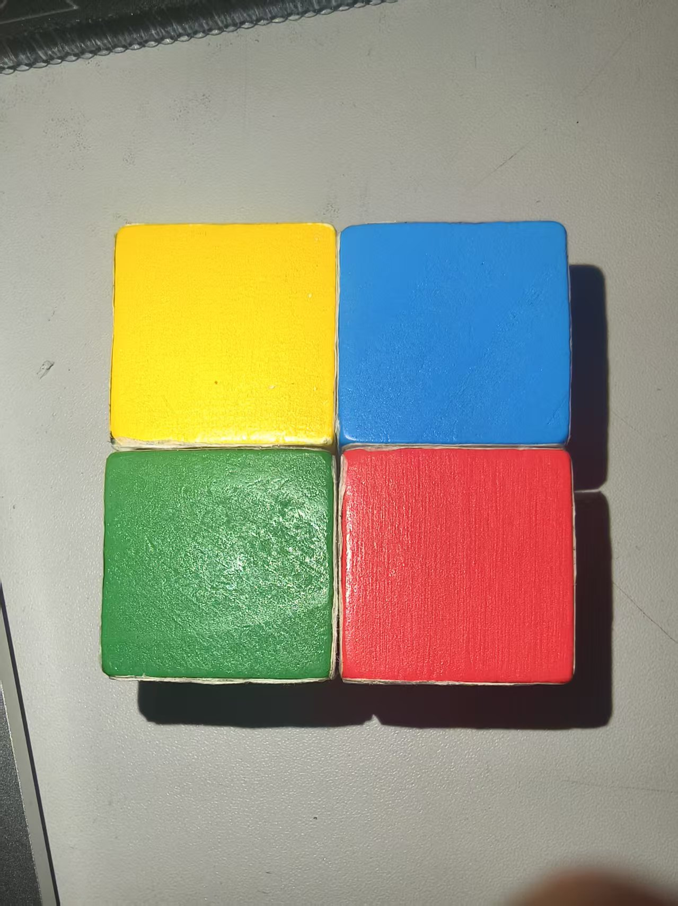
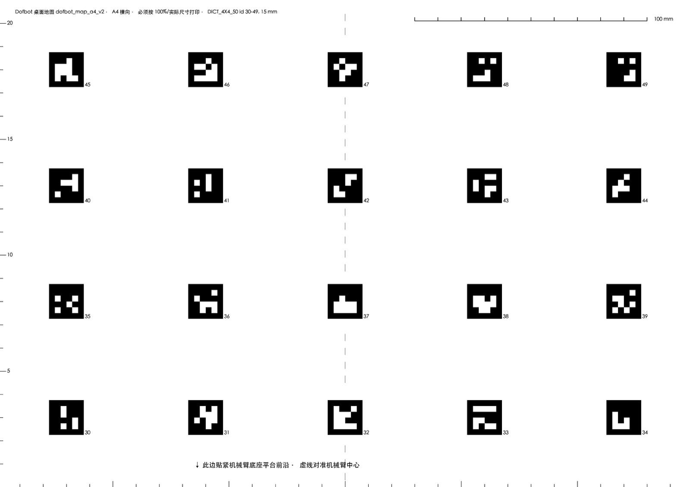
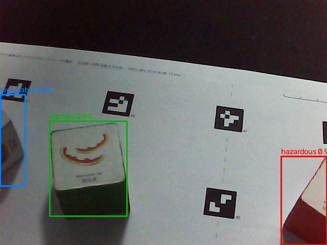
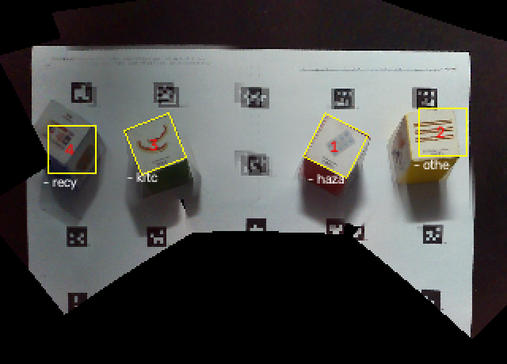

# 智能机械臂垃圾分拣与管理系统 · 需求说明

2026-10-09 需求审查。设备：昇腾 Atlas 200I DK A2 开发板、Dofbot 六舵机机械臂、装在腕部的一个单目相机。分拣对象：4 块 3 cm 贴纸方块，分属可回收、厨余、有害、其他四类。

## 一、做什么

桌上任意摆放的垃圾方块，机械臂自己看、自己算、抓起来投进对应的分类筐，并把每一步记到网页上。

*图 1 系统流程。实线框已在实机跑通，虚线框是接下来要做的。*

**基础内容（课程要求的四项）**：识别四类垃圾并给出位置；工作区内任意位置抓取并分类投放；网页实时显示全部作业日志；识别或抓取失败时自动处理，不需要人介入。基础之外我们自己加的内容单独列在第三节。

## 二、已经做过的实验

   

*图 2 从左到右：四块方块的纯色面；A4 桌面地图，20 个定位码；相机单个视角上的检测结果；11 个视角融合后的俯视图，黄框是算出的位置和朝向。*

| 实验 | 怎么做的 | 结果 |
|---|---|---|
| 训练识别模型 | 自己采集 160 张真实图，再合成 800 张；标注按“方块放在哪个定位码上”自动生成，不靠模型自己识别；验证用的整轮数据不参与训练 | mAP@0.5 为 **0.952** |
| 模型上板 | 转成昇腾格式，在开发板的 NPU 上推理，并与电脑上的结果逐框对照 | 单帧 **12.9 ms**，结果一致 |
| 定位评分 | 手摆 15 轮共 60 块，把算出的位置与摆放位置比较 | 60 块全部找到、类别全对；中心误差中位 0.0 cm，九成在 **1.04 cm** 以内 |
| 实机分拣 | 4 块随意摆放，全自动扫描、抓取、投放 | 最好一轮 **4 块全中，用时 99 秒**，单块中位 22 秒；累计 22 次抓取成功 18 次 |
| 触碰探测 | 夹爪闭合后竖直下探，用“指令在降、回读不降”判断碰到了什么 | 查出夹取位置一直偏高 **0.8 cm**，修复后一轮 4 块全部一次夹住 |

累计成功率混有修复前的数据，样本还不够，所以下面的分拣成功率按目标写。

## 三、基础之外的额外内容

带 ★ 的是课程给出的拓展示例，其余是我们自己提出的。“必做”与基础内容同等对待，“排期”是已排进时间表的，“备选”不排期。

| 额外内容 | 做到什么程度算通过 | 安排与负责人 |
| --- | --- | --- |
| 投进真实分类筐 | 四类各一个实体筐，筐口 ≥ 8 cm；连续 10 轮至少 8 轮全部投对，不碰倒筐 | **必做** · 硬件、抓取 |
| 网页控制面板 | 实时显示 6 个舵机角度（每秒 ≥ 2 次）；滑块调角度；输入坐标移动，误差 ≤ 1 cm；一键跳舞、搬运 | 排期 · 前端 |
| 三种作业模式 | 手动、预设动作、视觉自主，网页切换响应 ≤ 1 秒 | 排期 · 前端 |
| 记录导出、定时启动 | 导出 Excel 和 CSV，行数与记录一致；到点自动启动，偏差 ≤ 5 秒 | 排期 · 前端 |
| 声光状态反馈 | 成功绿灯、识别失败黄灯、抓取失败红灯并鸣一次，各试 10 次全对 | 排期 · 硬件 |
| 舵机堵转保护 | 人为挡住手臂 10 次检出 ≥ 9 次，0.5 秒内停止后续动作并告警 | 排期 · 硬件 |
| 多目标就近优先 | 按到基座的距离排序抓取，10 轮中至少 9 轮顺序正确 | 排期 · 抓取 |
| 未知物体告警 | 5 种非目标物体至少 4 种不抓，网页告警并保存现场图片 | 排期 · 抓取、前端 |
| 容器溢满检测 | 溢满判断准确率 ≥ 85%，溢满后停止投放并在网页提示 | 排期 · 硬件 |
| ★ 手势与表情交互 | 3 类手势识别 ≥ 80%，响应 ≤ 1.2 秒；笑脸触发挥手或点头 | 排期 · 硬件 |
| ★ 语音控制 | 启动、跳舞、停止 3 条指令识别 ≥ 80%，完成后语音播报 | 排期 · 硬件 |
| 手机端访问 | 手机上可看统计、可启停，与电脑端数据一致 | 排期 · 前端 |
| 堆叠优先抓取、自动搭积木塔 | 两项都要改抓取模型，以上全部完成后才考虑 | 备选 · 抓取 |

## 四、不做什么

| 不做 | 原因 |
|---|---|
| **压力传感（想要但放弃）** | 舵机只能读角度，读不到电流和负载；加传感器要改夹爪。改用指令与回读的差值判断接触 |
| **机械臂自动翻面（想要但放弃）** | 试过夹起倾斜后松手，两次都落回原来那一面，落点还偏了 3.6 cm。改为人工翻面 |
| 多机协同 | 只有一台机械臂 |
| 自动避障 | 运动走固定分段路径，只避开实测得到的底座平台区域，不做任意障碍物的轨迹规划 |
| 按形状区分抓取优先级 | 对象只有 3 cm 方块 |
| 非方块形状的真实垃圾 | 定位依赖“3 cm 立方体、顶面水平”这一前提 |
| 深度相机 | 触碰实测现有几何模型误差 0.15 cm，够用 |

## 五、基础内容的验收指标

| 功能 | 怎样算通过 | 现在 |
|---|---|---|
| 识别 | mAP@0.5 ≥ 0.90；板上单帧 ≤ 50 ms | 0.952；12.9 ms |
| 抓取投放 | 离基座 13–28 cm 内任意位置、任意朝向；连续 10 轮（每轮 4 块）至少 8 轮全中；单块 ≤ 30 秒 | 最好一轮 4/4；单块 22 秒；连续 10 轮未测 |
| 网页日志 | 4 个页面；事件从发生到显示 ≤ 1 秒；每条有时间、类别、位置、目标筐、耗时、结果 | 未开始 |
| 失败处理 | 连续 10 轮不需要人介入；一次失败处理 ≤ 5 秒；识别、抓取、投放、路径四类失败都有处理 | 7 条处理路径已有代码和测试，未按此口径测 |

## 六、模块之间传什么

| 从哪到哪 | 载体 | 主要字段（单位） |
|---|---|---|
| 识别定位 → 抓取 | 每轮扫描一个 JSON 文件 | 方块中心（厘米）、转角（度）、类别、是否位置近似 |
| 抓取 → 网页 | 日志文件，每行一个事件 | 时间（秒）、事件名、来源位置（厘米）、类别、目标筐、耗时（秒）、夹爪回读（度） |
| 网页、语音、手势 → 抓取 | 一条 JSON 指令 | 指令名、模式、六个舵机角度（度）、目标点（厘米）、来源 |

## 七、最可能卡住的地方：相机、硬件和机械臂的极限

| 限制来自 | 实测中的表现 | 卡住时怎么办 |
|---|---|---|
| **相机**：腕部单目，无深度，视场 36° | 一个视角最多看到地图的 29%，要扫 11 个视角约 55 秒；靠近基座只能斜着看，定位偏约 2 cm | 多视角融合加方块已知尺寸定位；近处的方块抓前先下探核对，仍不稳就缩小工作区 |
| **舵机**：只能读角度，读不到电流和力 | 夹爪有时不执行大幅度指令，22 次里 6 次；1–5 号舵机单独写入无效 | 一切判断只看回读角度；六个舵机统一批量写入；先夹，没动再唤醒重试，3 次不行就跳过并记日志 |
| **机械臂活动极限**：接近伸直或折到头时接近奇异位形 | 只有离基座 13–28 cm 可达；极限附近逆解无解或关节角突跳 16–22°；腕部只能转半圈，一半朝向对不齐 | 在多组俯角和半径里找解，突跳超阈值就拒绝执行；利用方块 90° 对称换一对面夹；够不到的跳过并记日志 |

## 八、分工与排期

四人各管一条线，每个阶段都有自己的活，**每两周一个验收点，功能做完就验**，不把验收堆到最后。里程碑：**11.13 中期展示**基础四项与真实筐现场可演示；12.18 验收测试并冻结；12.25 结题答辩。

| 阶段 | 识别与抓取 | 网页前端 | 硬件与交互 | 测试与文档 | 阶段末验收 |
|---|---|---|---|---|---|
| **今天各自讲** | 做什么、已做实验、识别与抓取的指标 | 网页日志、控制面板、模块接口 | 真实筐、交互类额外内容、三类极限 | 不做什么、失败处理、排期与验收 | — |
| 10.10–10.23 | 连续 10 轮成功率；指令执行与限位校验 | 日志 4 个页面、控制面板、导出 | 容器下单；时区校正；手势原型 | 验收用例；日志回放与失败注入工具 | 接口定稿；网页回放无丢失 |
| 10.24–11.6 | 投进真实筐；就近优先；未知物体判定 | 面板接实机；告警页；手机端骨架 | 容器标定；声光；堵转保护；语音原型 | 失败处理量化；基础四项与真实筐验收 | 基础四项与真实筐全部验收 |
| 11.14–11.27 | 近基座定位偏差处理；修集成缺陷 | 定时启动；溢满提示；手机端完成 | 溢满检测；手势、语音接实机 | 集成、系统测试；验收上阶段功能 | 测试报告；7 项功能验收 |
| 11.28–12.11 | 性能与光照试验 | 延迟与多端一致性测试 | 验收整改；摆位记录 | 性能测试；验收剩余功能 | 排期内功能全部有结论 |

**能并行的原因**：三个接口先定稿；网页用已有的真实日志回放，手势和语音先在电脑上做，容器到货前用纸盒代替。只有每周约 2 小时的实机时间要排队，按上机清单轮流。没通过验收的功能在下一阶段首周修复，优先于新功能。
